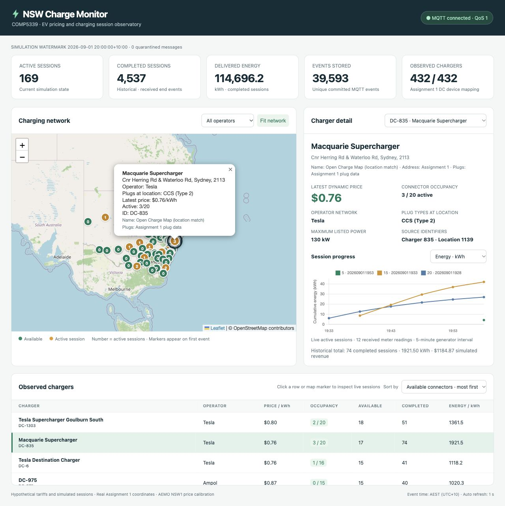

# NSW Charger Monitor

A course team project for streaming and analysing simulated EV charging activity across NSW. It combines a local MQTT broker, a Python subscriber, DuckDB event storage and an interactive Flask dashboard.



## What it does
- Replays ordered charging, metering and price events over MQTT.
- Maintains current station state and historical session metrics in DuckDB.
- Links a map, sortable charger table and station detail panel.
- Displays enrichment provenance for charger names, addresses and plug types.

The packaged simulation contains **432 devices, 46,084 events and 5,288 synthetic charging sessions**. Coordinates and enrichment are based on the team's Assignment 1 data; AEMO wholesale input calibrates the simulation. Charging occupancy, sessions and customer tariffs are synthetic, not a live public charging feed.

## My contribution
Chen Shi: MQTT publish/subscribe work and the real-time dashboard demonstration. The repository contains the **team implementation**; the full application and validation results are shared team deliverables, not individual-only work.

## Quick start
Python 3.12 is recommended. From this repository's root:

```bash
python3.12 -m venv .venv
.venv/bin/python -m pip install -r requirements.txt
```

Terminal 1:
```bash
.venv/bin/python run.py serve --fresh
```

Keep it running. In a second terminal, from the same folder:
```bash
.venv/bin/python run.py publish
```

Open http://127.0.0.1:8050. Both terminals are required: the first receives/stores events and serves the dashboard; the second publishes events. The full replay takes at least 76.8 minutes at the configured minimum 0.1-second interval. The map initially populates as events arrive.

For a shorter demo:
```bash
.venv/bin/python run.py demo --fresh --limit 300 --delay 0.5
```

Use this demo instead of the two-terminal full replay, after stopping any earlier services. On Windows, replace `.venv/bin/python` with `.venv\Scripts\python.exe`.

## Data and local files
The immutable `assignment1_reference/database/ev_chargers.duckdb` baseline is included because startup needs it. Generated input/event files are included for reproducible replay. Runtime databases under `database/`, virtual environments, logs and cache files are excluded. Local state is recreated by the launcher.

## Checks
```bash
.venv/bin/python -m unittest discover -s tests -v
```

See [technical notes](docs/technical-notes.md) for schemas, assumptions, original course packaging instructions and recorded validation evidence. Those notes preserve the original submission context; the pre-populated runtime database mentioned there is intentionally absent from this GitHub copy.

## Attribution
University of Sydney COMP5339 Assignment 2, course team project. The instructor-supplied data generator is retained with its original comments. Vendored frontend licenses remain in `static/vendor/`. OpenAI ChatGPT/Codex assistance is acknowledged in the original technical notes and affected files. No new license is asserted over course, team or third-party materials.
